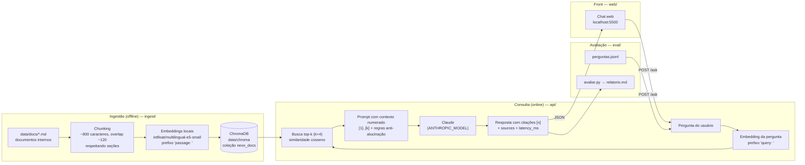

# Arquitetura — Assistente Interno RAG da Nexo Seguros

## Visão geral

O assistente responde perguntas de colaboradores usando **somente** os documentos internos da Nexo Seguros
(políticas de RH, manuais de sinistro, segurança, LGPD etc.). Cada resposta traz citações `[n]` que apontam
para os trechos usados, e o sistema recusa explicitamente quando a informação não está nos documentos.

## Componentes e donos

| Componente | Pasta | Dono | Interface |
|---|---|---|---|
| Documentos-fonte | `data/docs/` | Engenheiro de Dados | `*.md`, título na 1ª linha `# ...` |
| Ingestão | `ingest/` | Engenheiro de Dados | gera `data/chroma` / `nexo_docs` |
| API | `api/` | Engenheiro de Backend | `GET /health`, `POST /ask` (porta 8000) |
| Chat web | `web/` | Engenheiro de Frontend | `index.html` em `localhost:5500` |
| Avaliação | `eval/` | Engenheiro de QA | `eval/relatorio.md` |
| Integração, docs | raiz, `docs/`, `equipe/` | Tech Lead | `requirements.txt`, `run.ps1`/`run.sh`, README |

O contrato completo (formato do JSON, metadados, mensagem de recusa) está no `CLAUDE.md` e é a fonte da verdade.

## Decisões técnicas

### Embeddings locais (`intfloat/multilingual-e5-small`)
- **Gratuito e offline:** nenhum dado interno sai da máquina na etapa de indexação; só os trechos recuperados
  vão para o LLM. Coerente com a própria política da Nexo de não expor dados a IA pública.
- **Multilíngue:** os documentos e as perguntas são em português; o e5 multilíngue tem bom desempenho em PT-BR.
- **Pequeno (~120 MB, 384 dimensões):** roda em CPU, carrega em segundos, ingestão de dezenas de docs em < 1 min.
- **Prefixos obrigatórios:** o e5 foi treinado com `passage: ` para documentos e `query: ` para perguntas.
  Omitir os prefixos derruba a qualidade da busca de forma silenciosa — por isso estão no contrato.
- Vetores normalizados e similaridade **cosseno** (`hnsw:space = cosine`); `score = 1 − distância`.

### Tamanho de chunk (~800 caracteres, overlap ~120)
- Os documentos são políticas curtas, densas em fatos numéricos (prazos, valores, percentuais). Chunks de
  ~800 caracteres (~150–200 tokens) cabem uma seção inteira na maioria dos casos: o fato e seu contexto
  ("Nexo Auto" + "7 dias corridos") ficam juntos.
- Chunks grandes demais diluem o embedding (vários assuntos num vetor só) e gastam contexto do LLM;
  pequenos demais separam o número do assunto a que ele se refere.
- O chunking respeita os títulos de seção (`##`) e parágrafos antes de cortar por tamanho; o overlap evita perder
  um fato que cai na fronteira.
- O título do documento é mantido nos metadados (`titulo`) e pode ser prefixado ao texto do chunk para dar contexto.

### `top_k = 4`
- Com ~12–15 documentos e chunks de ~800 caracteres, 4 trechos (~3 mil caracteres) cobrem a resposta na grande
  maioria das perguntas e ainda deixam folga para perguntas que combinam dois documentos
  (ex.: "férias + day off").
- Mais trechos aumentam custo/latência e a chance de o modelo misturar fatos parecidos
  (ex.: prazos de sinistro Auto × Residencial). Menos trechos derrubam o recall@k.
- O valor é parâmetro do `/ask`, então o QA pode medir recall@k para k = 2, 4, 6 e ajustarmos com dados.

### Prompt anti-alucinação
O system prompt do Backend segue estas regras:
1. Responder **apenas** com base nos trechos fornecidos, numerados `[1]..[k]`.
2. Toda afirmação factual deve terminar com a citação do trecho de origem, ex.: `... 7 dias corridos [2].`
3. Se os trechos não contêm a resposta, responder **exatamente**:
   `Não encontrei essa informação nos documentos internos.` — sem tentar completar com conhecimento geral.
4. Não inventar números, nomes, e-mails ou telefones; copiar valores como estão no documento.
5. Responder em português, de forma objetiva.
- Os trechos vão delimitados (ex.: tags `<documento n="1" titulo="...">`) para o modelo não confundir instruções
  com conteúdo. Temperatura baixa (0–0.2) para respostas estáveis e avaliáveis.
- A frase de recusa é fixa porque o QA a verifica literalmente.

### Outras decisões
- **ChromaDB persistente** em `data/chroma`: sem servidor extra, arquivo local, fácil de recriar (`ingest` é
  idempotente e recria a coleção). Fica fora do git (`.gitignore`).
- **Modelo e cliente carregados uma vez** no startup da API — carregar o e5 por requisição custaria segundos.
- **Front sem build** (HTML/CSS/JS puro) servido por `python -m http.server`: zero dependências de Node.
- **CORS** liberado só para `http://localhost:5500`.
- **Segredos** apenas em `.env` (fora do git); `.env.example` documenta as variáveis.

## Como o QA mede qualidade

O QA mantém `eval/dataset.jsonl` com **50 perguntas** derivadas do `docs/briefing-empresa.md`: 40 respondíveis
(com `fatos_chave` e `doc_esperado`, incluindo variações informais e com erro de digitação) e 10 **não respondíveis**
(ex.: "Qual o salário do CEO?"). O `eval/run_eval.py` chama a API real (`POST /ask`). Métricas:

| Métrica | O que mede | Como |
|---|---|---|
| **Acurácia** | O LLM respondeu o fato certo? | todos os `fatos_chave` (ex.: "7 dias", "R$ 150,00") presentes na resposta |
| **Recuperação (hit@4)** | A busca trouxe o documento certo? | `doc_esperado` aparece em `sources` |
| **Recusa correta** | O sistema evita responder fora do escopo? | não respondíveis recebem a frase de recusa |
| **Alucinação** | O sistema inventa respostas? | não respondíveis em que ele respondeu algo |
| **Latência** | Experiência do usuário | média e p95 de `latency_ms` |

Separar **recuperação** (hit@4) de **geração** (acurácia) mostra onde está o erro: se o documento certo
não foi recuperado, o ajuste é no chunking/embeddings/top_k (Dados); se foi recuperado e a resposta está errada, o
ajuste é no prompt (Backend); se o fato nem está no documento, o ajuste é no conteúdo (Dados). Meta: acurácia ≥ 85%.
Abaixo disso, o QA registra o diagnóstico no QUADRO, o responsável corrige e o QA mostra antes × depois.
O resultado vai para `eval/relatorio.md` (+ `eval/resultados.csv`) e é copiado para o README.
